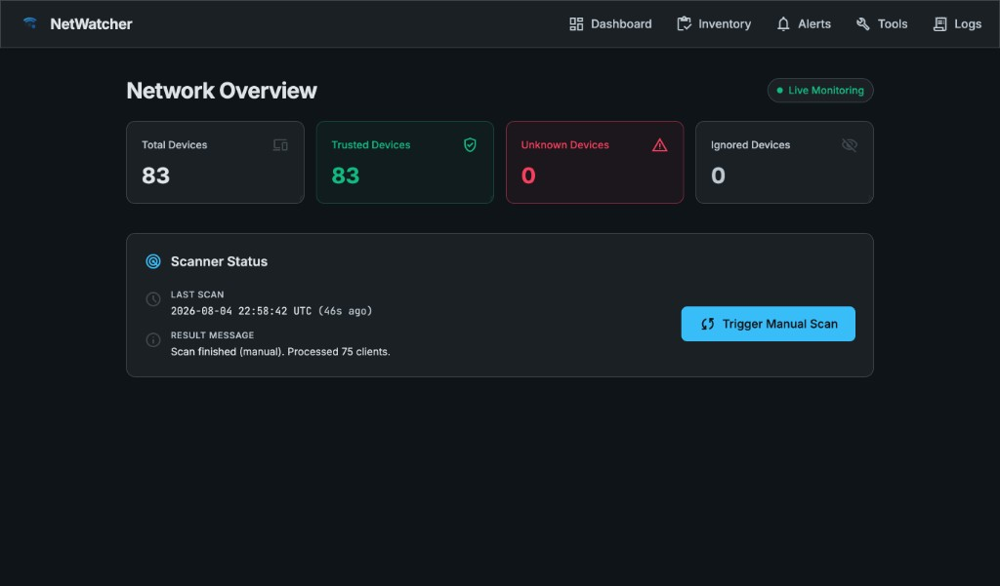

<p align="center">
  
</p>

<p align="center">
  
</p>

# NetWatcher for UniFi

> A lightweight UniFi unknown-device monitor with WebUI, SQLite history, approval workflow, and pluggable alerts.

I've wanted a lightweight monitor to routinely scan my home network for unknown devices. Normally [WatchYourLAN](https://github.com/aceberg/WatchYourLAN) and [NetAlertX](https://netalertx.com/) are the most popular options, but these are a bit heavy for my needs, and Ubiquiti offers a table via its administrative interface that can be scanned. I found [NetWatcher](https://github.com/coolcat1575/netwatcher/) but this was unmaintained and I wanted a solution I could plug into Docker or Proxmox easily to perform the same thing.

This project monitors your network for unknown MAC addresses using data from a UniFi Controller / UniFi Network Server and provides configurable alerts (Pushover, Webhooks, etc.). It acts as a lightweight, single-container alternative to heavy monitoring stacks.

## Features

- **Web Dashboard**: View unknown, trusted, and ignored devices.
- **Approval Workflow**: Click to trust or ignore devices directly from the UI.
- **Pluggable Notifications**: Native support for Pushover and Generic Webhooks.
- **Alert Deduplication**: Built-in cooldown prevents alert spam for the same device.
- **UniFi API Integration**: Fetches client statistics directly from the UniFi Controller.
- **Blocking**: Optional native UniFi blocking logic (supports Dry Run testing).
- **Import/Export**: Easy ingestion of legacy `trusted.txt` files and CSV exports.
- **Data Retention**: Configurable pruning of old observations and events (Tools UI or env).
- **Single-process scheduler**: Scans, OUI updates, and retention run inside the web process — deploy with one uvicorn worker and one replica (default Compose).

## Quick start

```bash
git clone https://github.com/andrewtryder/unifi-netwatcher.git
cd unifi-netwatcher
cp .env.example .env
```

Edit `.env` before starting the container. At minimum, set:

- `UNIFI_URL`
- `UNIFI_USERNAME`
- `UNIFI_PASSWORD` (must not be a placeholder when talking to a real controller)
- `UNIFI_SITE`
- `UNIFI_VERIFY_SSL`
- `UNIFI_MOCK_MODE=false`

Leave `APP_SECRET_KEY` empty so the container generates `data/app-secret.key` on first start (persisted in the Compose data volume).

Then start NetWatcher:

```bash
docker compose up -d
```

Open **http://localhost:8080** (or your host's IP on port 8080). Sign in with the bootstrap credentials **`admin` / `admin`**, then open **Security** and change the password immediately.

Images are published to [GHCR](https://github.com/andrewtryder/unifi-netwatcher/pkgs/container/unifi-netwatcher) and [Docker Hub](https://hub.docker.com/r/andrewtryder/unifi-netwatcher) on each release. `compose.yml` pulls from GHCR by default; pin a version by changing the image tag (e.g. `ghcr.io/andrewtryder/unifi-netwatcher:0.1.0`).

The published image runs as a non-root user (`uid`/`gid` `10001`) with a read-only root filesystem, dropped capabilities, and `no-new-privileges`. Production Compose uses a **named volume** (`netwatcher-data`) for `/app/data`, so ownership is handled inside the container—no host `chown` is required for a fresh install. Optional reverse-proxy bind to `127.0.0.1` is fine; the default `8080:8080` publish remains for typical LAN Docker deploys.

### Updates

```bash
docker compose pull
docker compose up -d
```

## Local development

### Native Python / Node

Requires [uv](https://docs.astral.sh/uv/), **Python 3.14+**, and Node 20+.

```bash
uv sync
npm ci && npm run build:css

cp .env.development.example .env
uv run alembic upgrade head
uv run uvicorn app.main:app --reload --port 8080
```

`.env.development.example` enables mock mode and a local-only secret. For production Docker installs, copy `.env.example` instead (empty `APP_SECRET_KEY`, `APP_ENV=production`).

See [CONTRIBUTING.md](CONTRIBUTING.md) for PR title conventions, hooks, and release flow.
### Docker-based development

Builds from source and enables mock mode via `compose.dev.yml` (bind-mounts `./data` for local inspection):

```bash
cp .env.example .env
mkdir -p data && sudo chown -R 10001:10001 data
docker compose -f compose.yml -f compose.dev.yml up --build
```

## Configuration

Copy `.env.example` (production / Docker) or `.env.development.example` (native local) to `.env` and adjust as needed. Notification channels (Pushover, webhooks, etc.) are configured in the Web UI, not via environment variables. Background jobs (scans, OUI updates, retention) share a single APScheduler inside the web process — keep one uvicorn worker and one replica.

| Variable | Description |
|---|---|
| `APP_ENV` | One of `production`, `development`, or `test`. Typos are rejected at startup. Development disables Jinja template bytecode caching. |
| `APP_SECRET_KEY` | Optional when a persisted key file is used. If set in production, must be a non-placeholder secret of at least 16 characters. Leave empty to generate `data/app-secret.key` on first start. |
| `APP_SECRET_KEY_PATH` | Path for the generated/persisted key file when `APP_SECRET_KEY` is empty. Default `data/app-secret.key` (mode `0600`). |
| `PUBLIC_ORIGIN` | Optional absolute browser origin (e.g. `https://netwatcher.home.arpa`) for same-origin checks behind an HTTPS reverse proxy. Leave empty for direct LAN access. |
| `IMPORT_MAX_BYTES` | Max trusted-import upload size (bytes). Default `1000000`. |
| `IMPORT_MAX_ROWS` | Max trusted-import data rows. Default `5000`. |
| `DATABASE_URL` | SQLite database path. Default `sqlite:///./data/netwatcher.db` (Compose mounts data at `/app/data` via the `netwatcher-data` volume). |
| `UNIFI_API_MODE` | API mode to communicate with UniFi: `legacy` (default, session cookies), `official` (REST Integration API v1 with API key), or `auto` (capability detection). |
| `UNIFI_API_KEY` | Secret API token for official API mode. Leave empty when using `legacy` mode. |
| `UNIFI_URL` | Base URL of your UniFi Network application (no trailing slash). |
| `UNIFI_USERNAME` | UniFi account username. A dedicated account with only the permissions needed is recommended. |
| `UNIFI_PASSWORD` | UniFi account password. |
| `UNIFI_SITE` | UniFi site name (usually `default`). |
| `UNIFI_VERIFY_SSL` | Verify the controller TLS certificate (`true`/`false`). Default `true`. Set `false` only on trusted LANs with self-signed certs. |
| `UNIFI_CA_BUNDLE` | Optional path to a CA certificate/bundle used when `UNIFI_VERIFY_SSL=true` (for self-signed UniFi controllers). Mount the file into the container and set this path. |
| `UNIFI_TIMEOUT_SECONDS` | HTTP timeout when calling the UniFi API. |
| `SCAN_INTERVAL_SECONDS` | How often to poll the controller for clients (seconds). Default: `300`. Overridable in **Tools**. |
| `DEVICE_OFFLINE_MISSED_SCANS` | Consecutive missed scans required before marking an observed device offline. Default: `2` (minimum `2`). |
| `DEVICE_OFFLINE_GRACE_SECONDS` | Minimum seconds a device must remain absent before transitioning to offline. Default: `600` (10 minutes). |
| `ALERT_COOLDOWN_SECONDS` | Minimum time between repeat alerts for newly discovered unknown devices (seconds). Default: `21600` (6 hours). |
| `NOTIFY_DEVICE_DISCONNECTED` | When `true`, dispatch alerts when an observed device goes offline. Default: `false` (disabled). Overridable in **Notifications**. |
| `NOTIFY_DEVICE_RECONNECTED` | When `true`, dispatch alerts when an offline device reconnects. Default: `false` (disabled). Overridable in **Notifications**. |
| `NOTIFY_DEVICE_SSID_CHANGED` | When `true`, dispatch alerts when an active device roams to a different Wi-Fi SSID. Default: `false` (disabled). Overridable in **Notifications**. |
| `NOTIFY_DEVICE_AP_CHANGED` | When `true`, dispatch alerts when an active device roams to a different Access Point. Default: `false` (disabled). Overridable in **Notifications**. |
| `NOTIFY_DEVICE_NETWORK_CHANGED` | When `true`, dispatch alerts when an active device's IP address or subnet changes. Default: `false` (disabled). Overridable in **Notifications**. |
| `BEHAVIORAL_ALERT_COOLDOWN_SECONDS` | Minimum seconds between repeat behavioral alerts for the same device and event type. Default: `3600` (1 hour). Overridable in **Notifications**. |
| `OBSERVATION_RETENTION_DAYS` | Delete observations older than this many days. Default: `30`. Use `0` to disable. Overridable in **Tools**. |
| `EVENT_RETENTION_DAYS` | Delete events (and related notification deliveries) older than this many days. Default: `90`. Use `0` to disable. Overridable in **Tools**. |
| `UNIFI_DRY_RUN_BLOCKS` | When `true`, log block actions without sending them to the controller. |
| `UNIFI_MOCK_MODE` | When `true`, use fixture data instead of a real controller. For demo/development only. |
| `WEBHOOK_ALLOWED_HOSTS` | Optional comma-separated hostnames allowed for outbound webhooks (SSRF allowlist bypass). |
| `SECURITY_RECOVERY_BYPASS` | Emergency only: when `true`, bypass CIDR **and** trusted-host filtering (does not disable auth or reset passwords). Default `false`. |

### UniFi API Modes

NetWatcher supports both the classic session-cookie authenticated controller API and modern REST Integration API (v1).

#### Legacy Mode (`UNIFI_API_MODE=legacy`, default)
Uses session cookies (`/api/auth/login`) with username and password. This is the default mode, compatible with all UniFi Controller and Network Application versions.
* **Capabilities**: Client inventory, Wi-Fi & switch port telemetry, client blocking (`block-sta` via `stamgr`).

#### Official Mode (`UNIFI_API_MODE=official`)
Uses the official Ubiquiti REST Integration API (v1) with `X-API-KEY` header authentication.
* **Requirements**: UniFi OS console (UDM, UDM Pro, UCG, CloudKey Gen2+) running Network 8.0+ / UniFi OS 3.2+.
* **Configuration**:
  ```env
  UNIFI_URL=https://192.168.1.1
  UNIFI_SITE=default
  UNIFI_API_MODE=official
  UNIFI_API_KEY=your-api-key-here
  UNIFI_VERIFY_SSL=true
  ```
* **Generating an API Key**:
  1. Open your local UniFi OS console settings or visit [unifi.ui.com](https://unifi.ui.com).
  2. Navigate to **Settings** ➔ **Integrations** (or **API Keys**).
  3. Create a new API Key with Read permissions for Network Clients and Sites.
* **Capabilities & Limitations**:
  * Full pagination and automatic single-site resolution (maps `default` to your console's site UUID).
  * Non-physical clients (such as active VPN or Teleport sessions without MAC addresses) are safely detected and skipped without interrupting LAN inventory polling.
  * **Client Blocking**: Ubiquiti's official Integration API v1 does not support permanent MAC blocking for arbitrary LAN clients. Deployments requiring device blocking should remain on `legacy` mode.

#### Auto Mode (`UNIFI_API_MODE=auto`)
Conservative capability probe: selects `official` mode if `UNIFI_API_KEY` is present and verified; falls back to `legacy` mode if unconfigured. Never silently switches between adapters on authentication or permission errors.

### Connection Diagnostics & Capability-Aware UI

NetWatcher features a **UniFi Connection & Scanner** diagnostics panel on the dashboard:

* **API Integration Details**: Shows configured mode (`Legacy`, `Official`, or `Auto-Detect`), active adapter, and configured site.
* **Health & Scan History**: Differentiates between background scanner health and application uptime. Shows latest scan timestamp, scan result, last successful scan, and sanitized error messages.
* **Declared Capabilities**: Explicitly lists features supported by the active adapter:
  | Capability | Legacy API Mode | Official API Mode |
  |---|---|---|
  | Client Inventory | Supported | Supported |
  | Client Blocking | Supported | Not Supported |
  | Client Unblocking | Supported | Not Supported |
  | Wi-Fi Telemetry | Available | Not Available |
  | Switch-Port Details | Available | Not Available |
  | API Pagination | Not Supported | Supported |
* **On-Demand Connection Testing**: Click **Test UniFi Connection** in the dashboard (or send an authenticated `POST /api/unifi/test-connection`) to run an immediate, isolated credential and reachability test. This test does not alter device inventory, record monitoring events, or dispatch alerts.
* **Server-Side Capability Enforcement**: If an action is not supported by the active adapter (e.g. attempting to block a client while running the official API), both the UI buttons are disabled with explanatory badges, and backend API routes reject the request with `HTTP 409 Conflict` without modifying device status or database state. Core workflows (Trust, Ignore, Reset, Delete, Rename) remain completely functional across all API modes.
* **Health vs Readiness vs Controller Connectivity**:
  * `/healthz`: Application process is running and responding to HTTP requests.
  * `/readyz`: Database connection and schema migrations are healthy. Controller disconnection does not fail readiness checks or trigger container restarts.
  * `/api/unifi/status`: Authenticated endpoint returning full UniFi integration and connection diagnostic metadata.

### Device Connectivity & Behavioral Events

NetWatcher tracks real-time network connectivity independently of administrative approval status:

* **Orthogonal State Machine**:
  * **Approval Status** (`unknown`, `trusted`, `ignored`, `blocked`): Represents administrative authorization.
  * **Connectivity State** (`online`, `offline`, `unknown`): Represents physical presence on the network. Trusting, ignoring, or blocking a device never alters its connectivity state, and disconnecting or reconnecting never alters its approval status.
* **Flapping & Noise Suppression**:
  * To avoid false alarms caused by momentary Wi-Fi roaming or sleep states, devices are not marked offline after a single missed scan.
  * An observed device transitions to `offline` only when **both** criteria are satisfied:
    1. It has missed at least `DEVICE_OFFLINE_MISSED_SCANS` consecutive scans (default: `2`).
    2. At least `DEVICE_OFFLINE_GRACE_SECONDS` have elapsed since the device was first observed missing (default: `600` seconds / 10 minutes).
* **Behavioral Event Generation**:
  * State transitions generate audit-logged behavioral events atomically within the scan transaction:
    * `device_disconnected`: Logged when an online device satisfies the offline threshold, recording duration online, consecutive missed scans, and offline transition timestamp.
    * `device_reconnected`: Logged when an offline device is observed active again, recording previous offline duration.
* **Roaming & Network Change Tracking**:
  * Active online devices are monitored for environmental and network transitions:
    * `device_ap_changed`: Recorded when a wireless client roams to a different Access Point (AP MAC). Transient missing AP metadata in controller responses is ignored to prevent flapping. Returning to a previously associated AP generates a clean roam event.
    * `device_ssid_changed`: Recorded when a wireless client connects to a different Wi-Fi SSID.
    * `device_network_changed`: Recorded when a client's IP address or subnet changes.
  * Roaming and network changes are tracked without resetting connectivity state or advancing missed-scan counters.
  * Baseline safety: Initial device discovery records initial network properties without firing spurious roaming or network change events.
* **Configurable Behavioral Notification Rules**:
  * Granular alert rules for device state changes and network events:
    * **Disconnections** (`NOTIFY_DEVICE_DISCONNECTED`): Alerts when a monitored device drops offline, including duration online.
    * **Reconnections** (`NOTIFY_DEVICE_RECONNECTED`): Alerts when an offline device reconnects, including previous offline duration.
    * **SSID Roaming** (`NOTIFY_DEVICE_SSID_CHANGED`): Alerts when a device switches Wi-Fi networks.
    * **AP Roaming** (`NOTIFY_DEVICE_AP_CHANGED`): Alerts when a device roams between access points.
    * **Network Changes** (`NOTIFY_DEVICE_NETWORK_CHANGED`): Alerts when a device receives a new IP address.
  * **Strict Opt-In**: All behavioral notifications are disabled by default (`false`) to prevent alert fatigue.
  * **Independent Per-Event Cooldown**: Each event type maintains an isolated cooldown per device (`BEHAVIORAL_ALERT_COOLDOWN_SECONDS`, default: `3600` seconds / 1 hour). A disconnection notification will never suppress a subsequent reconnection alert.
  * **Human-Friendly Formatting**: Notifications feature formatted uptime/downtime durations (e.g. `2 hours 15 minutes` or `45 seconds`) alongside device identification details (hostname, IP, MAC).
  * **Non-Blocking Dispatch**: Alert intents are queued during scanning and dispatched strictly after the database transaction commits, ensuring external notification latency never delays scan cycles.
  * **Runtime Configuration**: Rules and cooldown settings can be toggled and saved dynamically via the **Notifications** tab in the Web UI.
* **Connection History & Timeline UI**:
  * The device detail page (`/devices/{id}`) includes an interactive **Connection Timeline**:
    * Chronological list of transition events (disconnections, reconnections, AP roaming, SSID changes, IP changes, and discovery).
    * High-contrast visual badges and icons distinguish connection states and network shifts.
    * Contextual duration badges display active uptime or downtime spans between transitions.
    * HTMX-powered pagination ("Load more events") loads history in chunks without full page reloads.
    * Backed by an indexed SQLite query (`ix_events_device_id_created_at`) for high-performance retrieval on low-resource hardware.
    * Strict HTML escaping ensures all untrusted network, SSID, and device metadata is rendered safely against XSS attacks.
* **Outage & Empty-Scan Resilience**:
  * **Outage Immunity**: Controller communication failures, timeouts, or authentication errors abort the scan and freeze connectivity states and missed-scan counters. NetWatcher never falsely declares devices offline due to a controller outage.
  * **Empty Sites**: A valid, successful scan reporting zero connected clients is treated as an authoritative snapshot and correctly increments missed-scan counters toward offline confirmation.
* **Baseline Initialization**:
  * Pre-existing or newly imported devices initialize with `connectivity_state="unknown"`.
  * The first time an `unknown` device is seen online, its state transitions quietly to `online` without firing a spurious `device_reconnected` event.
  * Devices that remain absent while `unknown` stay in `unknown` state without incrementing missed-scan counters.
* **Web UI Inspection**:
  * The device detail view displays the device's current connectivity state, last connected timestamp, and last disconnected timestamp under Core Information, with the chronological transition history visualized directly below in the Connection Timeline.

## Releases

Versioning is automated with [Release Please](https://github.com/googleapis/release-please) using [Conventional Commits](https://www.conventionalcommits.org/). Merge the Release PR on `main` to cut a release and publish images to both registries.

| Prefix | Version bump |
|---|---|
| `fix:` | Patch |
| `feat:` | Minor |
| `feat!:` or `BREAKING CHANGE:` | Major |

## Security notes

NetWatcher includes **application-level HTTP Basic authentication** (enabled by default), **trusted-host restrictions** (enabled by default), and optional **CIDR source-IP restrictions**. The container still listens on `0.0.0.0:8080` so LAN devices can reach it; access control is enforced inside the app, not by binding to loopback.

### Default credentials (bootstrap only)

- Username: `admin`
- Password: `admin`

These are **bootstrap credentials**, not a secure default. Change the password immediately after first startup via **Security** in the Web UI. A persistent banner reminds you while the defaults remain active. The password is stored only as an Argon2 hash in SQLite — never in plaintext or in source control.

### Authentication modes

- **Enabled (default):** every page and API (except `/healthz`, `/readyz`, and `/static/*`) requires valid Basic credentials.
- **Disabled:** general routes are open to any client that can reach port 8080. The **Security** page and its save endpoints always require administrator credentials so an anonymous visitor cannot change policy after auth is turned off. Disabling auth requires the current password and an explicit confirmation checkbox.
- Saving a username or password change may cause the browser to prompt for credentials again.
- Usernames are limited to 1–64 ASCII characters (`A–Z`, `a–z`, `0–9`, `.`, `_`, `-`) and must not contain a colon.
- HTTP Basic credentials are base64-encoded, not encrypted. On a default plain-HTTP LAN deployment, authentication protects against casual access but not an on-path attacker. Terminate HTTPS at a local reverse proxy for high-security setups.

### Notification secret encryption

Notification channel configs (Pushover tokens, webhook URLs/headers) are stored encrypted at rest (`enc:v1:…`) using a Fernet key derived from `APP_SECRET_KEY`, or from a generated `data/app-secret.key` when the env secret is empty.

- **Back up the database and key file** before upgrades or key changes.
- Changing the secret without rekeying makes existing encrypted channels unreadable; the app refuses to start if encrypted rows cannot be decrypted.
- Rekey after rotating secrets (staged: verify → DB transaction → backup → atomic key replace):

```bash
OLD_APP_SECRET_KEY='previous-secret' uv run python -m app.cli rekey
# or generate a new key file safely:
uv run python -m app.cli rekey --old-key 'previous-secret' --generate-file
```

A failed rekey leaves the active key file and database unchanged. If activation fails after the DB commit, the new key remains at `app-secret.key.new` for manual recovery.
### Trusted hosts

Connect first via `http://<lan-ip>:8080` (private/loopback IP literals and `localhost` are allowed by default). Then add DNS names such as `netwatcher.home.arpa` under **Security → Trusted Hosts**.

- When enabled, arbitrary DNS `Host` values are rejected until listed.
- Preview shows the effective Host NetWatcher sees and whether it would remain allowed.
- A save that would lock out your current Host is rejected unless you check the override and type exactly `ALLOW LOCKOUT`.

### CIDR restrictions

Configure under **Security → Network Restrictions**:

```text
192.168.1.0/24
10.0.0.25/32
fd00:1234::/64
```

- Uses the direct peer address (`request.client.host`). **`X-Forwarded-For` / `X-Real-IP` are not trusted.**
- Preview shows the effective client IP NetWatcher sees and whether that IP would remain allowed.
- CIDR filtering cannot be enabled with an empty allowlist.
- A save that would lock out your current IP is rejected unless you check the override and type exactly `ALLOW LOCKOUT`. After a lockout you may need host/Docker console access or the recovery flag below.

### Emergency recovery

```bash
SECURITY_RECOVERY_BYPASS=true
```

When set, CIDR **and** trusted-host filtering are bypassed (authentication is unchanged; passwords are not reset). The app logs a prominent startup warning. Disable the flag after you regain access and fix the allowlist / trusted hosts.

### Other guidance

- **Do not expose NetWatcher to the public internet** without understanding that auth is a single shared admin account (HTTP Basic) and that disabling auth grants full administrative access to every reachable client.
- **Use a dedicated UniFi account** with only the permissions NetWatcher needs.
- **`UNIFI_VERIFY_SSL=true`** by default. For self-signed controllers, mount a CA and set `UNIFI_CA_BUNDLE`, or set `UNIFI_VERIFY_SSL=false` only on trusted LANs.
- Prefer **versioned image tags or digests** for production (`latest` is convenient, not a pin).
- Outbound webhook delivery pins DNS-resolved IPs at connect time; still consider an outbound firewall blocking loopback/RFC1918/link-local/metadata from the container as defense-in-depth.
- **Protect the data volume.** Notification secrets, UniFi configuration, password hashes, and `app-secret.key` live under `/app/data` (Compose volume `netwatcher-data`).
- Behind HTTPS, set **`PUBLIC_ORIGIN`** to the browser-facing origin so same-origin checks match the proxy scheme.
